# Energy Price Forecasting 
 
 
 
 


Time series public market auction price forecasting. Comparing different prediction horizon scenarios (hourly and daily), prediction models and contribution of feature engineering.

#### Results overview

|   Model  | Art. Feat |  Period [h] |   Horizon [h] |    MAE   |   RMSE   |
| -------- | --------- | ----------- | ------------- | -------- | -------- |
|  Prophet |    No     |      1      |       1       |   47.66  |   61.33  |
|  Prophet |    No     |      24     |       24      |   50.09  |   64.45  |
|  XGBoost |    No     |      1      |       1       |   21.10  |   29.38  |
|  XGBoost |    No     |      6      |       1       |   16.80  |   24.26  |
|  XGBoost |    No     |      24     |       1       |   15.29  |   21.02  |
|  XGBoost |    No     |      1      |       24      |   43.58  |   60.52  |
|  XGBoost |    No     |      6      |       24      |   47.17  |   64.92  |
|  XGBoost |    No     |      24     |       24      |   46.93  |   63.45  |
|  XGBoost |    Yes    |      1      |       1       |   14.93  |   23.06  |
|  XGBoost |    Yes    |      6      |       1       |   15.51  |   23.71  |
|  XGBoost |    Yes    |      24     |       1       |   13.81  |   19.92  |
|  XGBoost |    Yes    |      1      |       24      |   42.35  |   57.38  |
|  XGBoost |    Yes    |      6      |       24      |   42.13  |   57.54  |
|  XGBoost |    Yes    |      24     |       24      |   41.04  |   53.91  |
| CatBoost |    No     |      1      |       1       |   20.90  |   29.27  |
| CatBoost |    No     |      6      |       1       |   15.84  |   23.37  |
| CatBoost |    No     |      24     |       1       |   14.59  |   20.74  |
| CatBoost |    No     |      1      |       24      |   42.84  |   59.65  |
| CatBoost |    No     |      6      |       24      |   44.32  |   61.96  |
| CatBoost |    No     |      24     |       24      |   44.90  |   59.98  |
| CatBoost |    Yes    |      1      |       1       |   13.32  |   20.67  |
| CatBoost |    Yes    |      6      |       1       |   13.73  |   20.79  |
| CatBoost |    Yes    |      24     |       1       |     |   |
| CatBoost |    Yes    |      1      |       24      |   39.50  |   53.78  |
| CatBoost |    Yes    |      6      |       24      |   38.24  |   53.34  |
| CatBoost |    Yes    |      24     |       24      |     |    |
| LightGBM |    No     |      6      |       1       |   16.53  |   25.63  |
| LightGBM |    No     |      24     |       24      |   44.21  |   60.14  |
| LightGBM |    Yes    |      6      |       1       |   14.63  |   22.89  |
| LightGBM |    Yes    |      24     |       24      |   38.73  |   52.23  |

### Quick start 
```
git clone ...
cd price_forecasting
poetry install
poetry shell
(venv) python prophet_forecasting.py                            # evaluates Prophet model (writes df_resampled.csv)
(venv) python tree_forecasting.py -m catboost -l 24 -z 24       # evaluates tree based models (catboost, xgboost, lightgbm), -f adds artificial features
(venv) python calculate_profit.py -l 24 -z 24                   # calculate trading profit for all tree models run with these settings
(venv) python optimization.py                                   # evaluates optimization strategy
```
`tree_forecasting.py` saves the test set predictions of each run, `calculate_profit.py` compares all of them that exist for the given sample length and horizon (run each model with and without `-f` first).


## Dataset 
Hourly electicity prices from public european energy market over a 6 month period time window.

Data sources: 
- [https://www.smard.de](https://www.smard.de) (Bundesnetzagentur) 
- [https://transparency.entsoe.eu](https://transparency.entsoe.eu) 

Download as .csv file in various time resolutions.

## EDA 

### Table annotations 
Available dataset columns names.

- MTU (CET/CEST) $\rightarrow$ Time intervals [FROM, TO] in UTC+1 timezone 
- Day-ahead Price [EUR/MWh] $\rightarrow$ Target price column to be predicted 
- Currency $\rightarrow$ Price unit Euro (irrelevant for modeling) 
- BZN|DE-LU $\rightarrow$ Bidding zone Germany/Luxembourg 

---

### Market price raw data 
Electricity price of the public auction market.

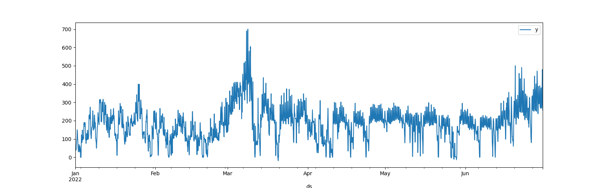
_Y Price [€/MWh] & ds [hour]_

__Observations__ 
- Noisy short term variability, next to long term repetitive cyclic patterns 
- External factors seems to cause unusual large outlier in early March 


### Time series statistics
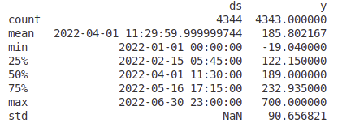

_ds: Time | y: Price_


### Preprocessing daily sample distribution 

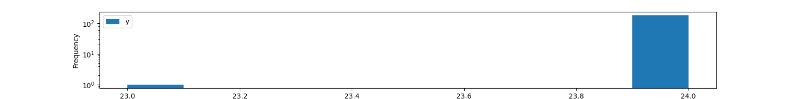
_(Log) Price samples per day historgram_

Gap localization over time.
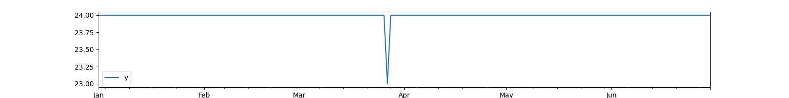
_Samples count per day_

Data cleansing by interpolation over small time step gaps.

#### Feature engineering 
Two situations with regards to the feature dimensions have been compared for the tree models. Raw time series only as feature input, in contrast to adding artificial features to every sample step: hour of day, day of week, price of the previous hour (lag1) and price difference to the previous hour (diff1).

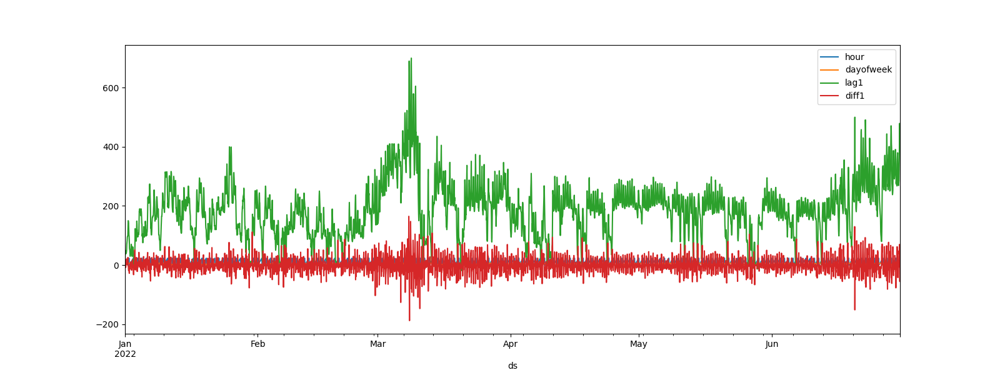
_Features over time_


## Forecast model (1. Prophet) 
__POC parametrization__ 
- Initial window size in days (120) $\rightarrow$ training window (the bigger the better) 
- Horizon in hours $\rightarrow$ prediction step size (how far to predict into the future) 
- Period in hours $\rightarrow$ number of prediction steps 
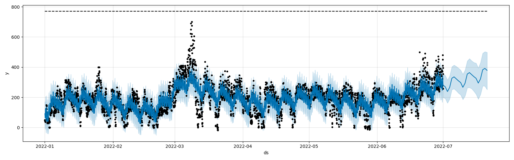 
_Y [Price in €/MWh] over time_

Legend: 
- Historical observations (black dots) 
- Confidence interval (light blue band) 
- Predictions (blue dense line) 
- Upper threshold limit (dashed black line) 

### Test set evaluation 
Time series cross validation is used to measure the forecast error using historical data. This is done by selecting cutoff points in the history, and for each of them fitting the model using data only up to that cutoff point. The forecasted values (_yhat_) are compared to the actual (_y_) values.

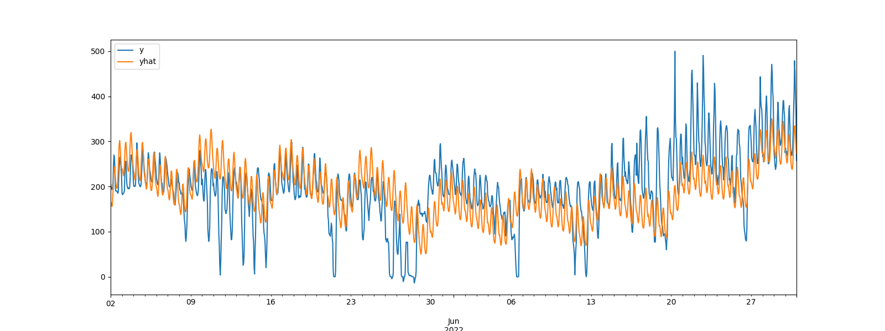 
_Prediction & observations over time for daily forecast horizon [Price in €/MWh]_

Metrics are below the pricings standard deviation of 90.656821, which means they are reasonable, but error metrics are still at quite high level. Hence the model did derive valuable information from the data, but it can be assumed that there is quite some potential left with dataset preprocessing and model selection. And most importantly the models parameters (e.g. sampling strategy) are just chosen for quick experimentation but not for optimal results and need more adjustment.


#### Review 

Prophet model for time series forecasting is exhausting its capability to handle high frequency, volatile from external unkown factors in the data and struggles to model irregular patterns.


## Forecast model (2. XGBoost) 
Boosting (unbalanced) tree based regression model for time series forecasting. 

### Test set evaluation  
Test set of the June hours: 672 samples for the daily horizon with 24h sample length and 713 samples for the hourly horizon with 6h sample length (deducting the first sample window and the last horizon hours without a known target price).
Two scenarios of hourly and one day ahead forecast horizons.

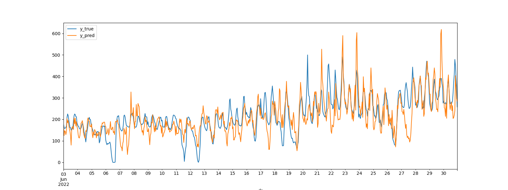 
_Prediction & observations for daily forecast horizon, no artifical features [Price in €/MWh]_

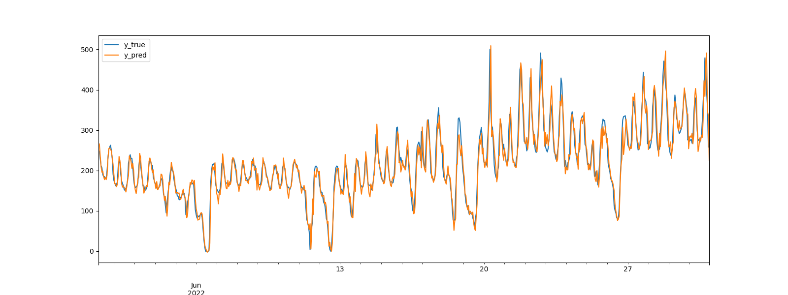 
_Prediction & observations for hourly forecast horizon, no artifical features [Price in €/MWh]_

__XGBoost with extended input feature dimensions__
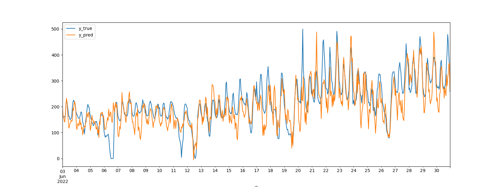 
_Prediction & observations for daily forecast horizon, artifical features added [Price in €/MWh]_

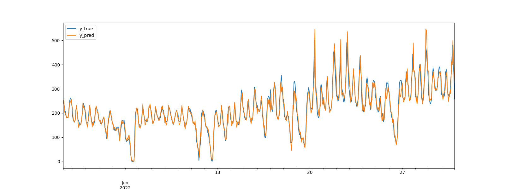 
_Prediction & observations for hourly forecast horizon, artifical features added [Price in €/MWh]_


#### Review 
The XGBoost model achieves significantly smaller error metrics on the evaluation sets for the short term prediction scenario and handles non saisonale spiky patterns better. While the tree based model outperforms the prohpet model on long term predictions on a smaller distance. Data set extension adding artificial feature dimensions improves the prediction accuracy in every setting, for the short as well as the long horizon scenario.


## Forecast model (3. CatBoost) 
CatBoost is known to excel even without extensive hyperparameter optimization building symmetric trees. 

### Test set evaluation  
Test set of the June hours: 672 samples for the daily horizon with 24h sample length and 713 samples for the hourly horizon with 6h sample length (deducting the first sample window and the last horizon hours without a known target price).
Two scenarios of hourly and one day ahead forecast horizons.

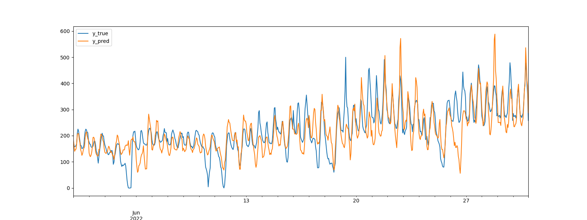 
_Prediction & observations for daily forecast horizon, no artifical features [Price in €/MWh]_

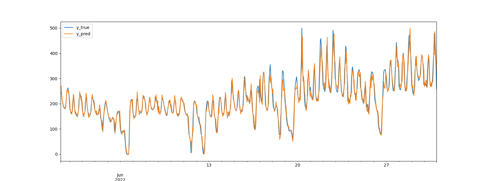 
_Prediction & observations for hourly forecast horizon, no artifical features [Price in €/MWh]_

__CatBoost with extended input feature dimensions__
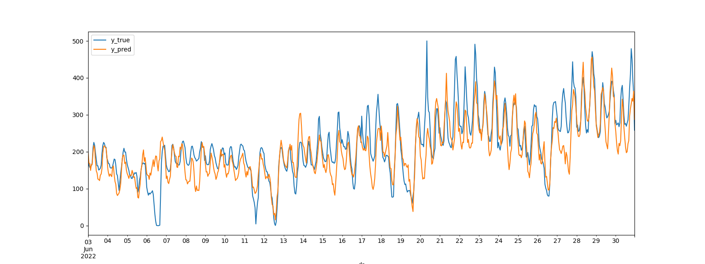 
_Prediction & observations for daily forecast horizon, artifical features added [Price in €/MWh]_

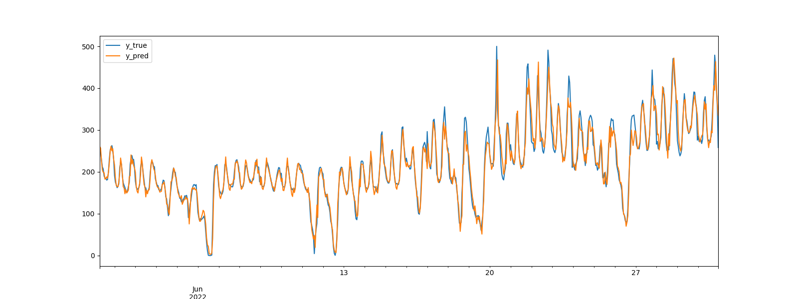 
_Prediction & observations for hourly forecast horizon, artifical features added [Price in €/MWh]_

#### Review 
Catboost outperforms XGBoost in every setting and the Prophet forecasting scenario. Like XGBoost it benefits from the extended feature dimension in both horizons and achieves the best results overall (MAE 12.64 hourly, 38.05 daily).

Overall it can be observed that the fitting effort for tree based models are multiple magnitudes smaller, than for non tree-based additive regression models like Prohpet. While both tree model approaches also achieved better results on the test set for energy price forecasting. 


## Optimization Strategy

__Task:__ Buy energy at cheap prices and store in batteries, to sell at future higher prices.

### Problem formalization 

Charging speed at time t: $c_t$

__Battery constraints__ 

Total  capacity: $0 <= SOC_t <= 1MWh$

Charging speed: $-1 <= c_t <= 1MWh/h$

Initial state: $SOC_0 = 0$ (battery starts empty)


__Trading actions__ 

$`c_t > 0 → `$ Charging/Buy 

$`c_t = 0 → `$ Idle/Hold 

$`c_t < 0 → `$ Discharging/Sell 


__State update__ $`SOC_{t+1} = SOC_t + c_t`$

__Optimizable cost function__ $`max ∑_t -price_t * c_t`$ (buying costs the price, selling earns it)

### Evaluation

The charge/discharge schedule is optimized with Linear Programming on the forecast prices of each model, but its profit is settled at the actual prices. Perfect foresight (schedule optimized on the actual prices) is therefore the upper bound no forecast can exceed. For simplicity the schedule is optimized over the whole test period at once, instead of being re-planned every day.

Test period June 3 - 30 (28 days) with the daily forecast horizon models (24h sample length). As baseline, the naive forecast takes the price of the same hour on the previous day.

### Optimization Results

| Model | Art. Feat | Total Profit | Avg Profit | % of Perfect | MAE | Cycles/day |
|-------|-----------|-------------|------------|--------------|-----|------------|
| Perfect foresight | - | 6,907.00 € | 246.68 €/day | 100.0% | - | 2.93 |
| Naive (previous day) | - | 5,169.49 € | 184.62 €/day | 74.8% | 42.30 | 2.86 |
| CatBoost | Yes | 5,092.78 € | 181.89 €/day | 73.7% | 38.05 | 3.93 |
| CatBoost | No | 4,682.19 € | 167.22 €/day | 67.8% | 44.90 | 3.21 |
| LightGBM | Yes | 4,494.04 € | 160.50 €/day | 65.1% | 38.73 | 4.54 |
| LightGBM | No | 3,963.16 € | 141.54 €/day | 57.4% | 44.21 | 4.68 |
| XGBoost | No | 3,433.27 € | 122.62 €/day | 49.7% | 46.93 | 5.57 |
| XGBoost | Yes | 3,259.95 € | 116.43 €/day | 47.2% | 41.04 | 5.50 |

Prophet is not part of the comparison, as there is no out-of-sample Prophet forecast for the test period: the saved forecast (`fcst.csv`) comes from the model fitted on the whole dataset including June, hence it is an in-sample fit for the test period.

**Why profit does not follow MAE:**

- **Price level errors are free** - the profit only depends on the price differences between charging and discharging hours. A forecast that is too low by the same amount in every hour leads to the same schedule, but to a high MAE. All tree models underestimate the mean price by 6-16 €/MWh.
- **Timing errors are expensive** - forecast noise creates price swings that do not exist, and the optimizer trades on them. XGBoost cycles the battery 5.6 times per day, almost twice as often as perfect foresight (2.9). On its own forecast prices the XGBoost schedule promises 10,822.82 €, more than perfect foresight, but settled at the actual prices it earns 3,433.27 €. Scoring a schedule on the prices it was optimized for overrates noisy forecasts and is no valid model comparison.
- **The naive forecast has realistic timing** - it repeats the actual price curve of the previous day, cycles as often as perfect foresight and is the most profitable forecast, despite a higher MAE than the models with artificial features.

**Key findings:**
- No forecast reaches perfect foresight, the best ones capture ~74% of the achievable profit
- The best model (CatBoost with artificial features) is only on par with the naive baseline in profit, although its MAE is 10% lower
- A lower MAE does not guarantee a higher profit: XGBoost with artificial features has a lower MAE than CatBoost without (41.04 vs 44.90), but earns 30% less
- Artificial features improve the MAE of all models by 12-15% and the profit of CatBoost (+5.9 pp) and LightGBM (+7.7 pp), but not of XGBoost (-2.5 pp)
- For arbitrage, the timing of cheap and expensive hours matters more than exact price values, so models should be selected by settled profit and not by MAE alone

